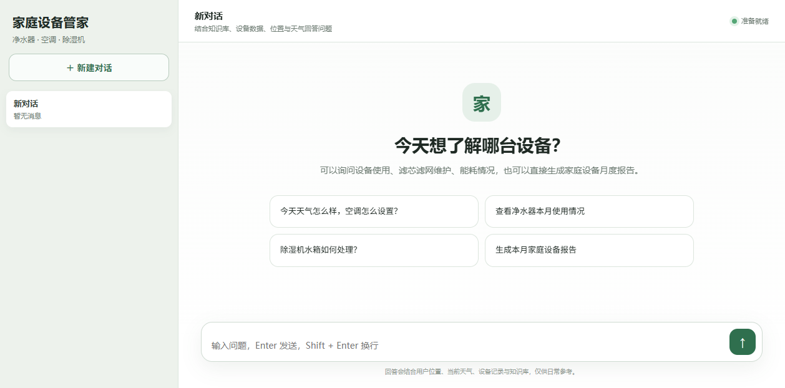
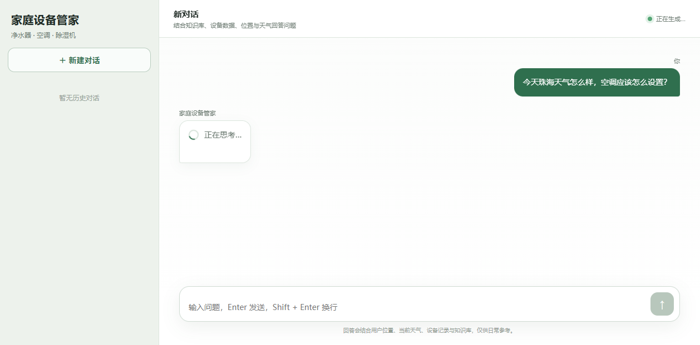
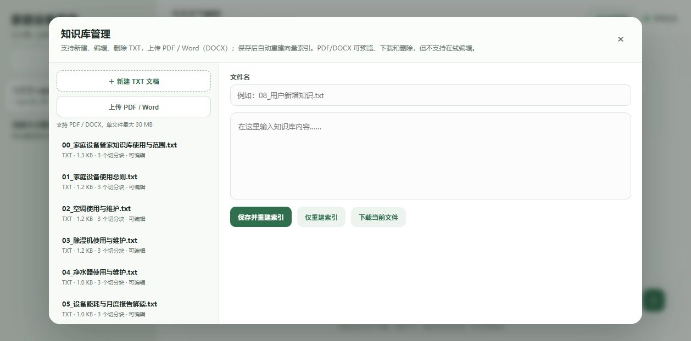
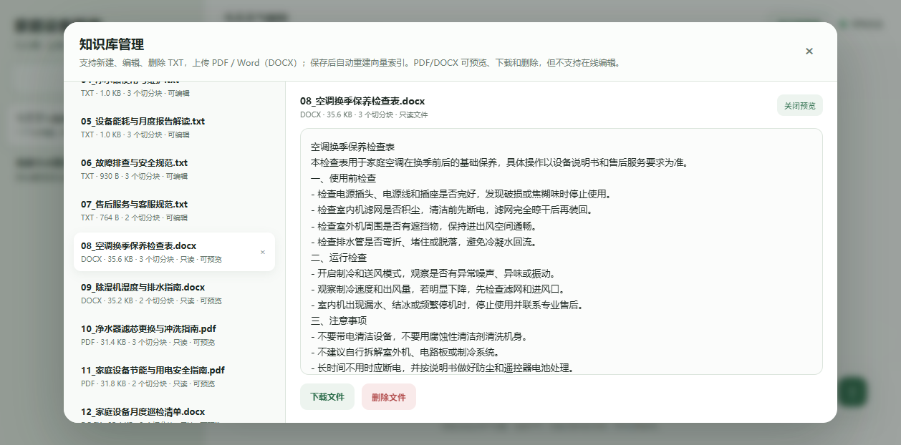
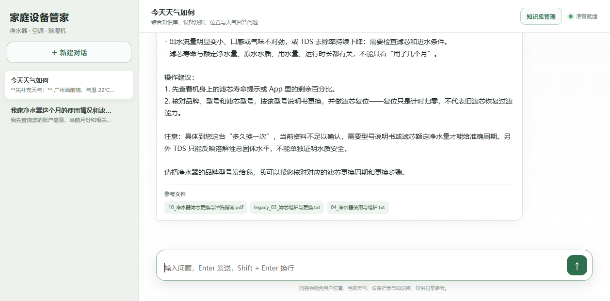
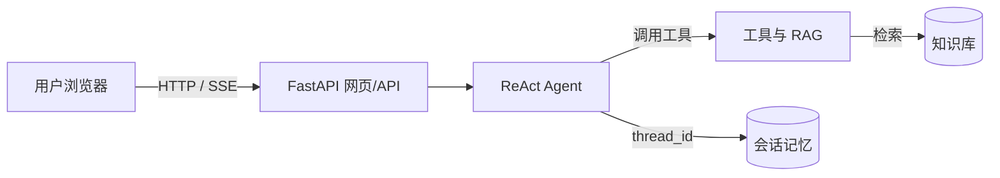

# 家庭设备管家 Agent

基于 **LangChain ReAct Agent + RAG + LangGraph Checkpointer + FastAPI** 构建的家庭设备智能助手，面向净水器、空调、除湿机等家庭设备，提供知识问答、天气建议、设备数据分析、月度报告和知识库管理。

---

## 功能演示

### 网页聊天



### 流式回答与等待动画



### 知识库管理



### PDF / DOCX 只读预览



### 回答引用来源文件



主要功能：

- 网页聊天，通过 SSE 逐段返回回答；
- 回答等待期间显示旋转加载动画；
- 自动结合位置、实时天气、设备数据和知识库；
- 支持多轮对话、历史会话恢复、会话删除；
- 支持生成家庭设备健康与能耗报告；
- 知识库支持 TXT、PDF、DOCX；
- 网页可新增、编辑、删除 TXT；
- 网页可上传 PDF / Word（DOCX）；
- PDF/DOCX 支持只读预览和下载；
- 文件列表显示每个文件的切分块数量；
- 回答末尾显示参考来源文件；
- 删除、上传和重建时显示进度提示；
- 知识文件变更后自动重建向量索引；
- 使用 LangGraph `SqliteSaver` 持久化 Agent 记忆。

---

## 快速启动

### 1. 进入项目

```powershell
cd "home-appliance-agent"
```

### 2. 激活虚拟环境

```powershell
.\.venv\Scripts\Activate.ps1
```

### 3. 安装依赖

```powershell
pip install -r requirements.txt
```

### 4. 启动服务

```powershell
.\.venv\Scripts\python.exe -m uvicorn app:app --host 127.0.0.1 --port 8000 --reload
```

### 5. 打开网页

```text
http://127.0.0.1:8000
```

也可以直接运行：

```powershell
.\.venv\Scripts\python.exe app.py
```

### PyCharm 快捷启动

1. 打开 `app.py`；
2. 右下角选择 `.venv` 解释器；
3. 右键 `app.py`，选择 `Run 'app'`；
4. 浏览器访问 `http://127.0.0.1:8000`。

推荐运行配置：

```text
Script path: app.py
Working directory: 项目根目录
Python interpreter: .venv\Scripts\python.exe
```

---

## 环境变量

复制示例配置并填写自己的密钥：

```powershell
Copy-Item .env.example .env
```

`.env` 内容示例：

| 变量 | 必填 | 说明 |
|---|---|---|
| `OPENAI_API_BASE` | 是 | OpenAI 兼容接口地址，例如 DashScope |
| `OPENAI_API_KEY` | 是 | 模型 API Key |
| `QWEATHER_API_KEY` | 是 | 和风天气 API Key |
| `QWEATHER_API_HOST` | 是 | 和风天气控制台分配的 API Host |
| `AGENT_USER_ID` | 否 | 默认用户 ID，默认 `user_001` |

示例：

```env
OPENAI_API_BASE=https://dashscope.aliyuncs.com/compatible-mode/v1
OPENAI_API_KEY=你的模型APIKey

QWEATHER_API_KEY=你的和风天气Key
QWEATHER_API_HOST=你的和风天气APIHost

AGENT_USER_ID=user_001
```

注意：不要将 `.env` 提交到 Git。

---

## 持久记忆说明

### 存储位置

Agent 记忆模块代码位于 `chat_history/`，运行数据位于：

```text
chat_history/data/checkpoints.db
```

核心代码位于 `chat_history/memory.py`：

```python
from langgraph.checkpoint.sqlite import SqliteSaver

class ChatMemory:
    def __init__(self):
        self.checkpoint_conn = sqlite3.connect(
            self.checkpoint_db,
            check_same_thread=False,
            timeout=15,
        )
        self.checkpointer = SqliteSaver(self.checkpoint_conn)
```

`ReactAgent` 只通过记忆模块接入：

```python
self.memory = ChatMemory()
self.agent = create_agent(
    ...,
    checkpointer=self.memory.checkpointer,
)
```

### 工作方式

- 每个网页会话使用独立的 `thread_id`；
- 同一个 `thread_id` 下的多轮消息由 Checkpointer 自动保存；
- 服务重启后历史消息仍可恢复；
- 网页会话列表和消息都从 Checkpointer 读取；
- 删除会话时调用 `checkpointer.delete_thread(thread_id)`；
- 回答参考来源保存在 `chat_history/data/sources.json`，用于历史消息恢复时显示来源。

> 当前版本使用 `SqliteSaver + sources.json` 实现会话级持久记忆，尚未启用 `InMemoryStore` 或 `SqliteStore` 跨会话长期语义记忆。

### 清空记忆

先停止服务，再删除：

```text
chat_history/data/checkpoints.db
chat_history/data/checkpoints.db-wal
chat_history/data/checkpoints.db-shm
```

下次启动会自动创建新的空数据库。

---

## 架构

### 架构流程图

主图只展示核心链路，具体模块职责见下方模块表。



### 核心模块

| 模块 | 文件/目录 | 核心职责 | 关键输入 | 关键输出 |
|---|---|---|---|---|
| 网页界面 | `web/index.html` | 聊天交互、历史会话、流式回答、知识库管理、PDF/DOCX 预览和下载 | 用户输入、API 响应、SSE 事件 | 页面交互、聊天请求、知识库操作 |
| Web / API 层 | `app.py` | FastAPI 路由、SSE 聊天接口、会话接口、知识库 CRUD、文件上传、预览、下载和索引重建触发 | HTTP 请求、上传文件、thread_id | JSON、SSE 流、文件流 |
| Agent 编排 | `agent/react_agent.py` | 创建 ReAct Agent，通过 `ChatMemory` 接入 Checkpointer，按 thread_id 执行会话 | 用户问题、thread_id、runtime context | 流式回答、线程消息 |
| 工具层 | `agent/tools/agent_tools.py` | 提供 RAG、天气、位置、用户 ID、当前月份、外部设备数据和报告触发工具 | 工具参数 | 工具结果文本 |
| 中间件 | `agent/tools/middleware.py` | 监控工具调用、注入报告上下文、切换动态提示词 | 工具调用、runtime context | 报告上下文、系统提示词 |
| RAG 服务 | `rag/rag_service.py` | 检索知识、记录命中来源、调用模型总结 | 用户问题、检索 query | 总结文本、来源文件列表 |
| 向量存储 | `rag/vector_store.py` | 加载 TXT/PDF/DOCX、文本切分、Chroma 入库、索引重建、切分块统计 | 知识文件 | 向量索引、chunk_count |
| 知识库 | `data/knowledge_base/` | 保存可被 RAG 读取的原始知识文件 | 上传、编辑、删除的文件 | TXT、PDF、DOCX 文件 |
| 持久记忆 | `chat_history/memory.py` + `chat_history/data/checkpoints.db` | 封装 LangGraph `SqliteSaver`，保存线程状态、消息和来源 | thread_id、消息 | 多轮对话状态、来源记录 |
| 来源记录 | `chat_history/data/sources.json` | 保存每次回答命中的参考文件 | thread_id、来源文件列表 | 历史回答的来源信息 |
| 外部设备数据 | `data/external_data.json` | 保存按用户和月份组织的设备运行记录 | user_id、month | 设备指标、维护和告警数据 |
| 提示词 | `prompts/` | 定义主助手、RAG 总结和月度报告的行为规范 | 运行时上下文 | 系统提示词、报告模板 |

### 关键链路

1. **聊天链路**：浏览器 → FastAPI → ReAct Agent → 工具/RAG → 流式回答 → Checkpointer 保存记忆。
2. **知识检索链路**：ReAct Agent → `rag_summarize` → Chroma → `data/knowledge_base/` → 返回答案和参考文件。
3. **知识库更新链路**：网页上传/编辑/删除 → FastAPI 写入文件 → 重建向量索引 → 新知识参与后续问答。
4. **会话展示链路**：网页 → FastAPI → Checkpointer 读取线程消息 → 恢复历史对话和参考来源。

---

## 使用示例

### 普通设备问答

```text
我家净水器滤芯还剩 15%，需要现在更换吗？
```

### 天气与设备建议

```text
今天湿度很高，空调和除湿机应该怎么设置？
```

### 生成月度报告

```text
请生成本月家庭设备健康与能耗报告
```

### 通过接口聊天

```powershell
$body = @{ message = "除湿机水箱快满了怎么办？"; conversation_id = $null } | ConvertTo-Json
Invoke-WebRequest -Uri "http://127.0.0.1:8000/api/chat" `
  -Method Post -ContentType "application/json" -Body $body
```

### 上传 PDF / Word

网页右上角进入“知识库管理”，点击“上传 PDF / Word”，选择 `.pdf` 或 `.docx` 文件。上传后会自动重建向量索引。

### 新建或编辑 TXT

在“知识库管理”中点击“新建 TXT 文档”，填写文件名和内容，点击“保存并重建索引”。

---

## 注意事项

1. **网页端可编辑 TXT；PDF / DOCX 支持只读预览、下载和删除，不支持在线编辑。**
2. 上传 PDF / DOCX 单文件最大 30 MB，前端会在上传前校验大小，后端也会再次校验。
3. 知识库保存、上传或删除后会重建全部向量索引，过程可能需要几秒，页面会显示进度提示，期间尽量避免同时提问。
4. 当前天气工具只提供实时天气，不提供未来天气预报。
5. 位置来自 IP 定位，可能不够精确；正式环境建议使用用户资料中的地址。
6. 外部设备数据目前来自本地 `data/external_data.json`。
7. `getaddrinfo failed` 通常是网络或 DNS 问题，代码已加入一次自动重试。
8. 当前项目没有登录、权限隔离和 HTTPS，适合本地演示和课程项目。
9. 报告内容仅用于日常使用参考，不能替代设备说明书、专业检测或维修服务。

---

## 知识库

统一目录：

```text
data/knowledge_base/
```

当前支持：

```text
.txt
.pdf
.docx
```

当前新增的示例文档：

```text
08_空调换季保养检查表.docx
09_除湿机湿度与排水指南.docx
10_净水器滤芯更换与冲洗指南.pdf
11_家庭设备节能与用电安全指南.pdf
12_家庭设备月度巡检清单.docx
```

向量库配置：

```yaml
collection_name: knowledge_base_agent
data_path: data/knowledge_base
allow_knowledge_file_type: ["txt", "pdf", "docx"]
```

### 知识库 API

```text
GET    /api/knowledge                      获取知识文件列表（含切分块数量）
GET    /api/knowledge/file?filename=...    读取 TXT 内容
GET    /api/knowledge/preview?filename=... 获取只读预览
GET    /api/knowledge/raw?filename=...     内嵌预览原始文件
GET    /api/knowledge/download?filename=...下载知识文件
POST   /api/knowledge/file                 新建或保存 TXT
POST   /api/knowledge/upload               上传 PDF / DOCX
DELETE /api/knowledge/file?filename=...    删除知识文件
POST   /api/knowledge/rebuild              重建向量索引
```

文件列表会返回 `chunk_count`，表示该文件当前在 Chroma 中的切分块数量。

---

## 项目结构

```text
home-appliance-agent/
├─ agent/
│  ├─ react_agent.py
│  └─ tools/
│     ├─ agent_tools.py
│     └─ middleware.py
├─ chat_history/                    # 记忆模块
│  ├─ __init__.py
│  ├─ memory.py                     # Checkpointer、线程消息、来源
│  ├─ storage.py                    # 来源 JSON 持久化
│  └─ data/                         # 运行时记忆数据
│     ├─ checkpoints.db
│     └─ sources.json
├─ config/
│  ├─ agent.yml
│  ├─ chroma.yml
│  ├─ prompts.yml
│  └─ rag.yml
├─ data/
│  ├─ knowledge_base/               # TXT / PDF / DOCX
│  ├─ external_data.json
│  └─ README.md
├─ docs/
│  └─ images/                       # README 演示截图
├─ prompts/
│  ├─ main_prompt.txt
│  ├─ report_prompt.txt
│  └─ rag_summarize.txt
├─ rag/
│  ├─ rag_service.py
│  └─ vector_store.py
├─ utils/
│  └─ file_handler.py               # TXT / PDF / DOCX 加载器
├─ web/
│  └─ index.html
├─ app.py
├─ requirements-web.txt
├─ requirements.txt
├─ md5.text
└─ README.md
```

---

## 测试与验证

已验证：

- DOCX 段落和表格可以解析并进入 Chroma；
- PDF 文本可以解析并进入 Chroma；
- 网页可上传 DOCX 和 PDF，并自动重建索引；
- 网页可读取、编辑、保存和删除 TXT；
- PDF/DOCX 可只读预览和下载；
- 文件列表显示每个知识文件的切分块数量；
- 回答末尾显示参考来源文件；
- 删除和重建索引期间显示进度提示；
- Checkpointer 可以保存多轮对话，服务重启后可恢复；
- 等待动画、流式回答和历史会话正常工作。

---

## 说明

本项目适合本地演示、课程项目和个人 Agent 实验。正式部署前建议增加用户认证、文件权限校验、上传病毒扫描、HTTPS、限流、日志脱敏和数据库备份。
